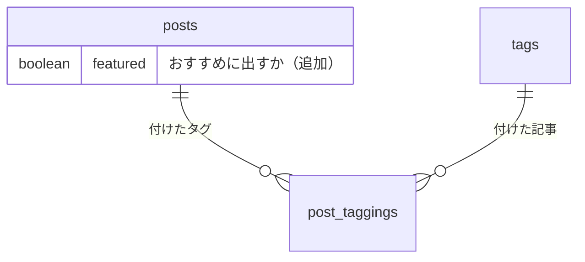

# /creating-pull-requests スキル

gitのコミット情報の解析からdraft PR作成まで一気通貫で行う。
PRタイトルとdescriptionをコミットメッセージから自動生成することで、手作業でのコピペや整形を不要にする。

## 手順

### ステップ1: ベースブランチを決める

PRのマージ先（ベースブランチ）を次の順で決める。以降の `<base>` はここで決めたブランチを指す:

1. 引数で指定されたブランチ
2. `git config branch.<現在のブランチ>.gh-merge-base` の値（`/creating-git-branches` が作成元を記録している）
3. リポジトリのデフォルトブランチ

```bash
git config "branch.$(git branch --show-current).gh-merge-base"
gh repo view --json defaultBranchRef --jq '.defaultBranchRef.name'
```

`gh pr create` も `--base` がなければ同じ順で決めるが、確認と rebase に使うため、ここで明示的に決めておく

### ステップ2: 現状を把握する

以下を**並列**で実行し、PRに含まれるコミットと変更内容を把握する:

```bash
git branch --show-current
git log --oneline <base>..HEAD
git log <base>..HEAD --reverse --format='%B---COMMIT_SEPARATOR---'
git diff <base>..HEAD --name-only
```

**中断条件** — 以下のいずれかに該当する場合は処理を止め、理由を伝える:

- 現ブランチがベースブランチまたはデフォルトブランチである — 保護ブランチへの直接pushが発生するため
- ベースブランチからのコミットがない — PRに含める変更がないため

### ステップ3: PRタイトルを組み立てる

PRタイトルは、コミットメッセージの1行目と同じ形（Conventional Commits の prefix 付き）にする。squash でマージしたときに、そのままコミットの1行目になるため。

- コミットが1つなら、その1行目をそのまま使う
- コミットが複数あるなら、PR 全体の変更を表す1行を、コミットメッセージの1行目の規則（prefix、体言止め、50文字以内）で書く。prefix は変更の主な目的に合うものを選ぶ

```
feat: 記事の一覧と詳細を返す API を追加
fix: ログイン時のエラーハンドリングを修正
```

### ステップ4: PR descriptionを作成する

プロジェクトに `.github/PULL_REQUEST_TEMPLATE.md` がある場合はそれを読み込み、ベースにする。

コミットメッセージの本文（3行目以降）を、テンプレートの冒頭コメント・ヘッダ行の直後・最初の `##` 見出しの手前に挿入する。`## 動作確認` は後述の手順に従って埋め、それ以外のセクション（`## チェックリスト` 等）はそのまま残す。

**挿入イメージ（テンプレートがある場合）:**

```markdown
※リリースフローについては [deploy.md](...) を確認してください。

[コミットメッセージの3行目以降をここに挿入]

## 動作確認

...
```

テンプレートがない場合は、コミットメッセージの本文（3行目以降）をそのまま description とする。

**複数コミットがある場合:**

- 「なぜ必要なのか？」に相当する背景・課題の記述は、各コミットの内容が自然につながるよう文章としてまとめ直す
- 「変更内容」に相当する箇条書きも、コミット単位ではなく変更の意味単位でまとめる

#### テーブルを足したとき

migration でテーブルを足したり、テーブル同士の関係を変えたりした場合は、変更内容の後に mermaid の ER 図を入れる。GitHub が図として描くので、コミットメッセージの ASCII アートの図より読みやすい。足したテーブルと、それにつながる既存のテーブルだけを描く。

````markdown

````

#### 画面を変えたとき

変更前後の画像と動画は、PR を出したあとに `uploading-pr-media` が本文に追記する。画像と動画は PR に添付して上げるので、PR がまだないここでは書かない。

#### 動作確認の記載

`## 動作確認` には、レビュアーが手動で画面上から確かめるべき項目をチェックリスト形式で記載する。

dev-flow.md（`"$(git rev-parse --absolute-git-dir)/dev-flow.md"`）に「動作確認」の節があれば、その項目をそのまま写す（その下の「テストを足すもの」は写さない）。動画はその項目に沿って撮ってあり、変えると合わなくなるため。なければ `planning-manual-checks` で項目を決める。

テンプレートに `## 動作確認` がある場合はその配下に挿入し、ない場合は変更内容の後にセクションごと追加する。

#### 文章の見直し

複数コミットをまとめ直した文章は、`reviewing-writing` スキルで見直してから提示する。動作確認の項目は `planning-manual-checks` で、コミットメッセージをそのまま使った部分は `/committing-git-changes` で見直し済みなので、手を入れない。

### ステップ5: ユーザーに確認する

以下を提示して承認を得る:

- **PRタイトル**
- **PR description**（全文）
- **ベースブランチ**: `<base>`（ステップ1でどの方法で決めたかを添える）

ユーザーがタイトルやdescriptionの修正を求めた場合は反映してから進む。

### ステップ6: rebase & push & PR作成

承認後、以下を順に実行する:

1. ベースブランチの最新をrebase:
   ```bash
   git pull --rebase origin <base>
   ```
   コンフリクトが発生した場合はユーザーに伝えて処理を中断する。自動でコンフリクト解消は行わない。

2. リモートにpush（未pushの場合）:
   ```bash
   git push -u origin HEAD
   ```

3. draft PRを作成:
   ```bash
   gh pr create --draft --base <base> --title "タイトル" --body "$(cat <<'EOF'
   description全文
   EOF
   )"
   ```

4. Copilot にレビューを依頼する:
   ```bash
   gh pr edit <PRのURL> --add-reviewer @copilot
   ```
   失敗したら、そのリポジトリでは Copilot のコードレビューが使えない。PR の作成は済んでいるので止めず、依頼できなかったことを伝える。

5. ベースブランチがリポジトリのベースでなく、まだマージされていない作業ブランチなら、`stacking-pull-requests` の 2 で GitHub のスタックにつなぐ。

6. 作成されたPRのURLと、Copilot に依頼できたか、スタックにつないだかをユーザーに表示する。

## 禁止事項

- ユーザーの承認なしに `git push` や `gh pr create` を実行しない — 共有リポジトリへの操作は確認が必須
- ベースブランチやデフォルトブランチの上では絶対にpushしない — 保護ブランチへの直接pushは事故のもと
- コミットの作成・変更はしない — それは `/committing-git-changes` の役割
